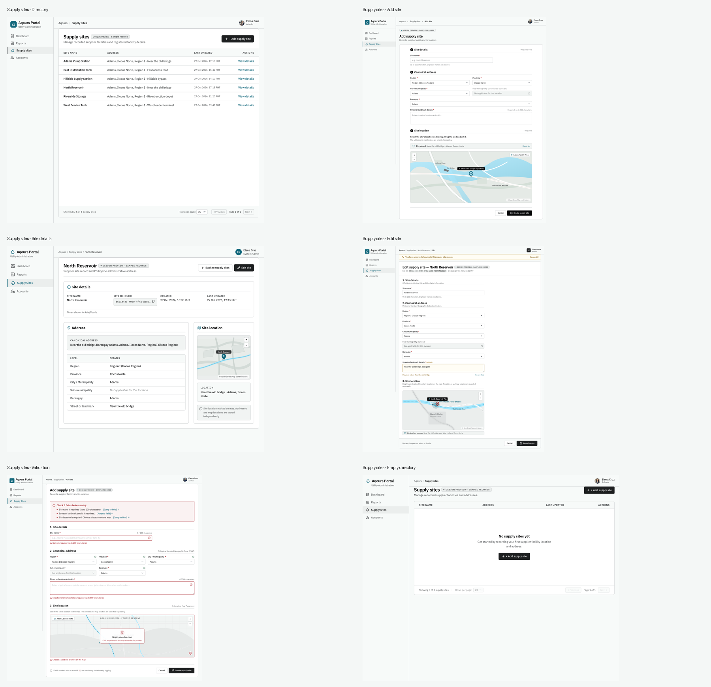

# Supply site management — Stitch design review

Design proposal awaiting review. No React, shared UI, API, routes, or database changes were made.

[Open the existing Aqours web project in Google Stitch](https://stitch.withgoogle.com/projects/5821335657238034680).

## Preview

| Screen            | PNG preview                                      | Stitch HTML export                                 |
| ----------------- | ------------------------------------------------ | -------------------------------------------------- |
| Directory         | [01-directory.png](01-directory.png)             | [01-directory.html](01-directory.html)             |
| Add supply site   | [02-add-site.png](02-add-site.png)               | [02-add-site.html](02-add-site.html)               |
| Site details      | [03-site-details.png](03-site-details.png)       | [03-site-details.html](03-site-details.html)       |
| Edit supply site  | [04-edit-site.png](04-edit-site.png)             | [04-edit-site.html](04-edit-site.html)             |
| Validation errors | [05-validation.png](05-validation.png)           | [05-validation.html](05-validation.html)           |
| Empty directory   | [06-empty-directory.png](06-empty-directory.png) | [06-empty-directory.html](06-empty-directory.html) |

PNG files are the saved visual proposals. HTML files are static Stitch exports with formatting normalized for inspection; they are not integrated application screens and may load external fonts/styles. Application behavior and API integration have not been implemented or tested.

The latest user revision is applied throughout: users see addresses and map locations only, with no latitude/longitude values or inputs. Directory rows show addresses; Add/Edit use a map-pin design, Details includes a read-only map, and location errors use plain language. The map artwork is illustrative; these exports do not contain a working Leaflet/Geoapify integration.

## Context and provenance

The complete [design brief](design-brief.md) includes the source spec, implemented endpoint DTOs, Application validation code, and the user's newer map/address requirement. The [generation request](generation-request.json), [accuracy-pass request](refinement-request.json), [map revision](map-revision-request.json), [copy cleanup](cleanup-request.json), [design-system snapshot](design-system.json), and [screen manifest](manifest.json) preserve the context and remote asset identifiers for revisions. [Review notes](review-notes.md) distinguish visual observations from Stitch's own generation notes.

The direction is the existing **framed-sheet** Aqours supplier portal, with IBM Plex Sans, a pale water-tinted frame, teal identity and near-black actions. The direction sheet uses seed 1021459911; brand palette and type were retained. Shell dimensions follow the existing portal rather than replacing it with the direction library's defaults. The product signature is the Philippine administrative address hierarchy beside the site's selected map location.

All site names, details and timestamps are fictional review fixtures. The selected North Reservoir uses the spec's valid Region I → Ilocos Norte → Adams → Adams codes, checked against the repository's shared PSGC dataset. The directory has six sample records sorted by name; it does not imply a connected supplier database.

## Scope

Admin-only directory, create, read and full-update workflows. No delete, archive, search/filter endpoint, geocoding, supply monitoring, weather warning, dispatch or capacity feature is authorized by the implemented API. The map picker is a design proposal explicitly requested by the user; a future implementation would submit its selected coordinates internally to the existing API without displaying the numbers. The address and map location remain independent.

Each screen answers one task: which sites are recorded; how to add one; what is recorded; how to correct it; which fields need attention; and how to add the first record. The next step is user review and requested design revisions.
