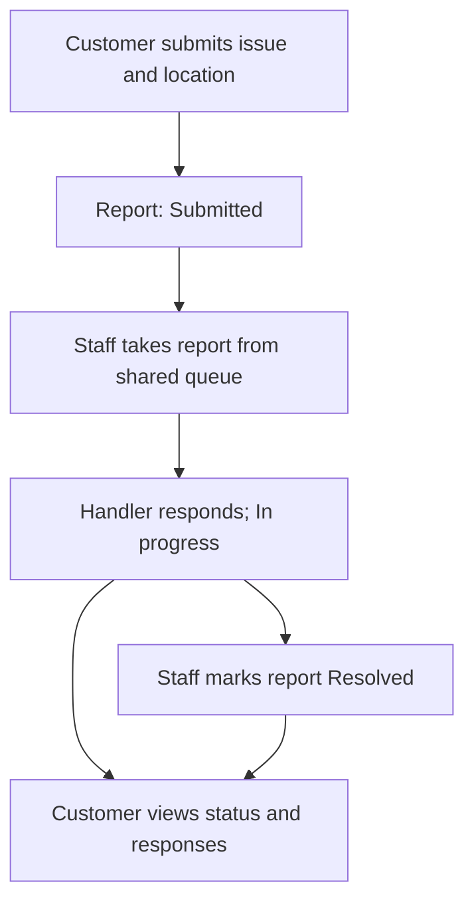
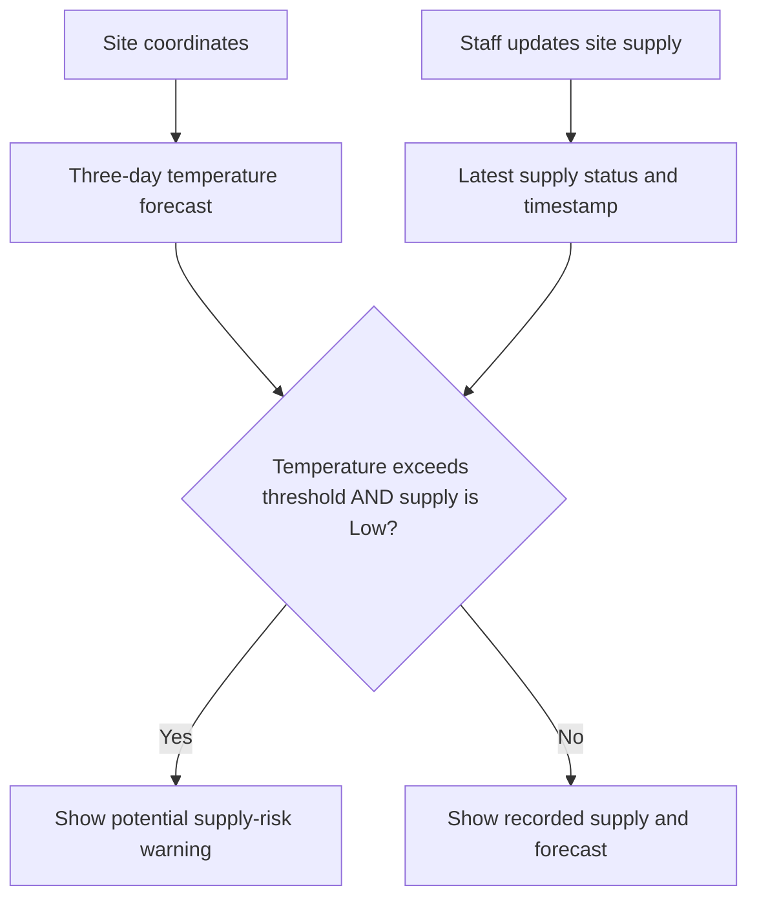

# Water Reporting and Response System — App Context & MVP

> This document defines the hackathon MVP. Account authentication, the Customer reporting API, and the Staff report queue and ticket workspace have been implemented; other workflows below describe product scope and are not implied to be implemented.

## 1. App context

A simple water reporting, supplier response, and manual water supply monitoring system. Customers use a mobile app to report local water problems and track responses. Water supplier administrators and staff use a web portal to manage reports, update supply availability, and review weather-based warnings.

**Core outcome:** a customer submits a located water report, supplier staff respond and resolve it, and the customer can track the progress.

**Delivery window:** approximately one week.

**Scope assumption:** one supplier organization with multiple supply sites and service areas.

## 2. Users and responsibilities

| Role | Interface | MVP responsibilities |
| --- | --- | --- |
| Supplier admin | Web portal | Create staff accounts, manage sites and service areas, configure warning thresholds, view overview dashboards |
| Supplier staff | Web portal | View the shared report queue, take reports, add response notes, update report statuses, manually update site supply |
| Customer | Mobile app | View supplier sites, submit reports with locations, track their own reports and responses |

## 3. MVP features

### 3.1 Authentication and roles

- Login for supplier admin, supplier staff, and customer.
- Restrict pages and backend actions according to the user's role.
- Customers can access only their own reports.
- Only authorized supplier personnel can access customer report locations.

**Implemented account and Customer reporting API slices:** Admin and Staff use the supplier web portal; Customer accounts use the mobile API. The API supports seeded Admin setup, Admin account creation, web cookie sessions, mobile Customer JWT and refresh sessions, forced first-login password changes, and role checks. Authenticated Customers with completed password setup can submit reports and access only their own report list and details through the API. The Staff report queue and ticket workspace is implemented with its API, messaging, and SignalR contracts. The Customer mobile application, supply monitoring, weather warnings, and maps remain deferred. See [the authentication feature spec](features/authentication/spec.md), [Customer reporting API spec](features/customer-reporting/specs.md), and [Staff report workspace spec](features/staff-report-workspace/spec.md).

### 3.2 Customer water reporting

Customers submit a report containing:

- Issue type, such as no water, low pressure, or dirty water.
- Description.
- Address.
- Report location selected using current location or a manually dropped map pin.

The report location represents where the problem occurs. It may differ from the customer's current location.

### 3.3 Staff report queue and response

- New reports appear in a shared incoming queue for supplier staff.
- A staff member clicks **Take report** to become its handler; the report changes from Submitted to In progress.
- The handler adds response or progress notes and marks the report Resolved when complete.
- Record the handler and claim time so staff know who is responsible.
- Claim reports atomically: if two staff try to take the same report, only the first successful claim is accepted.
- Admin monitors unhandled reports and progress through overview dashboards; routine assignment and response are staff responsibilities.
- Customers can see the response and current status.

**Statuses:** `Submitted` → `InProgress` → `Resolved`. Only the assigned Staff member can resolve an in-progress report; reports cannot be reassigned or reopened. See the [Staff report workspace spec](features/staff-report-workspace/spec.md).

### 3.4 Customer report tracking

- List the customer's own reports.
- Open report details to view the issue, location, status, and supplier responses.
- Keep the report status consistent between the mobile app and supplier portal.

### 3.5 Manual supply monitoring

- Record supply availability per site: **Normal**, **Low**, or **Unavailable**.
- Record who updated the site and when.
- Display the latest recorded supply status and update time.
- Make clear that these values are manually entered, rather than live sensor readings.
- Keep low and unavailable supply visible even when no weather warning applies.

### 3.6 Maps

| Map view | Information shown | Interaction |
| --- | --- | --- |
| Customer app | Supplier site pins and the customer's location with permission | Tap a site to see its name, address, supply status, and last update |
| Customer report form | Location of the reported problem | Use current location or manually drop a pin |
| Supplier portal | Supplier sites and authorized report locations | Tap reports to view issue, handler, status, and location |

Customers see supplier sites and their own reports. Do not expose other customers' report locations. Live tracking and route navigation are outside scope.

### 3.7 Weather-based early warnings

- Retrieve the next three days of forecast temperatures using each site's coordinates.
- Allow the admin to configure a heat threshold as a **demo setting**.
- Evaluate the forecast maximum temperature for each forecast day.
- Highlight a site on the supplier dashboard and map when the combined warning rule is met.
- Re-evaluate warnings when forecasts refresh or site supply changes.

**Combined rule:**

```text
Forecast maximum temperature > configured temperature threshold
AND
Latest recorded site supply status = Low
→ Show potential supply-risk warning
```

The PDF uses strictly **exceeds** the threshold. An unavailable site remains visibly unavailable; it does not need this combined rule to communicate its supply problem.

Display:

- Affected site.
- Forecast date and maximum temperature.
- Latest recorded supply status.
- Supply update timestamp.
- Any missing or stale data limitation.

**Example warning:**

> High temperature forecast tomorrow. This site's latest recorded supply is low. Review available stock and prepare replenishment.

This feature forecasts weather and flags possible supply risk. It does not predict when water will run out or identify an El Niño event. The threshold is not an official danger level.

## 4. Workflow visuals

### Report to resolution



### Weather and supply warning



Missing or stale data must be identified in the interface; it must not silently appear to confirm that a site has no risk.

## 5. Suggested minimum screens

These screens organize the agreed features; they are implementation guidance rather than additional scope.

### Customer mobile app

1. Login.
2. Supplier map with site details.
3. Submit report with location selection.
4. My reports.
5. Report details, status, and supplier responses.

### Supplier web portal

1. Login.
2. Dashboard showing report counts, site supply, and warnings.
3. Staff shared report queue and report details with Take report, response, and resolution controls.
4. Operational map showing sites and authorized report pins.
5. Admin site management and staff supply updates.
6. Admin settings for staff, service areas, and demo heat thresholds.

Combine screens where useful to keep implementation small.

## 6. One-week delivery plan

| Day | Focus | Expected output |
| --- | --- | --- |
| 1 | Foundation | Database, role-based access, seeded demo accounts and sites |
| 2 | Customer reporting | Submission, report list, and report details |
| 3 | Supplier response | Shared queue, staff claiming, response notes, and status tracking |
| 4 | Supply and maps | Manual site updates, supplier pins, and report pins |
| 5 | Weather warnings | Forecast integration, configurable rule, and warning display |
| 6 | Integration and testing | Verify permissions, locations, status changes, and missing-data behavior |
| 7 | Demo buffer | Fix issues, polish screens, and rehearse the demonstration |

If time gets tight, simplify styling and extra screens first.

## 7. Definition of done

- [ ] Customer can log in and submit a water issue with a selected location.
- [ ] Staff can see incoming reports and take responsibility without admin assignment.
- [ ] Taking a report records its handler and changes its status to In progress.
- [ ] Concurrent claims cannot give one report multiple handlers.
- [ ] The handler can add responses and mark the report Resolved.
- [ ] Admin can manage users and configuration and monitor reports through overview dashboards.
- [ ] Customer can view the report status and supplier responses in the mobile app.
- [ ] Staff can update a site's supply status, with updater and timestamp recorded.
- [ ] Customer can locate supplier sites and inspect their supply information.
- [ ] Authorized staff can locate reports on the portal map.
- [ ] Heat forecast plus recorded low supply triggers a clearly labeled warning.
- [ ] Missing or stale forecast and supply data are clearly indicated.
- [ ] Customers cannot access other customers' reports or locations.

## 8. Outside the MVP

- Live chat.
- Live customer tracking.
- Route navigation.
- Sensor hardware and real-time water readings.
- Automated water-depletion prediction.
- El Niño event detection.
- Payments.
- Complex analytics.
- Supervisor roles, manual admin assignment, and complex assignment rules.

## 9. Implementation context and open choices

The product brief does not prescribe a technology stack. The required stack is defined by [architecture](architecture.md): ASP.NET Core Minimal APIs, a React web SPA, and React Native with Expo for mobile. Account authentication and the Customer API for report submission, customer-owned listing, and detail retrieval are implemented. The Staff report queue and ticket workspace are implemented. The mobile client, supply monitoring, weather warnings, and maps remain deferred.

Before implementing the remaining workflow slices, settle:

- Final project name: Aqours or Upwards.
- Weather API provider and forecast refresh interval.
- Demo temperature threshold and how it is configured.
- What age makes supply or forecast data stale.
- How reports are associated with service areas and supplier sites.

Keep implementation focused on one complete reporting-and-response flow, manual supply visibility, simple maps, and the transparent weather warning rule.
